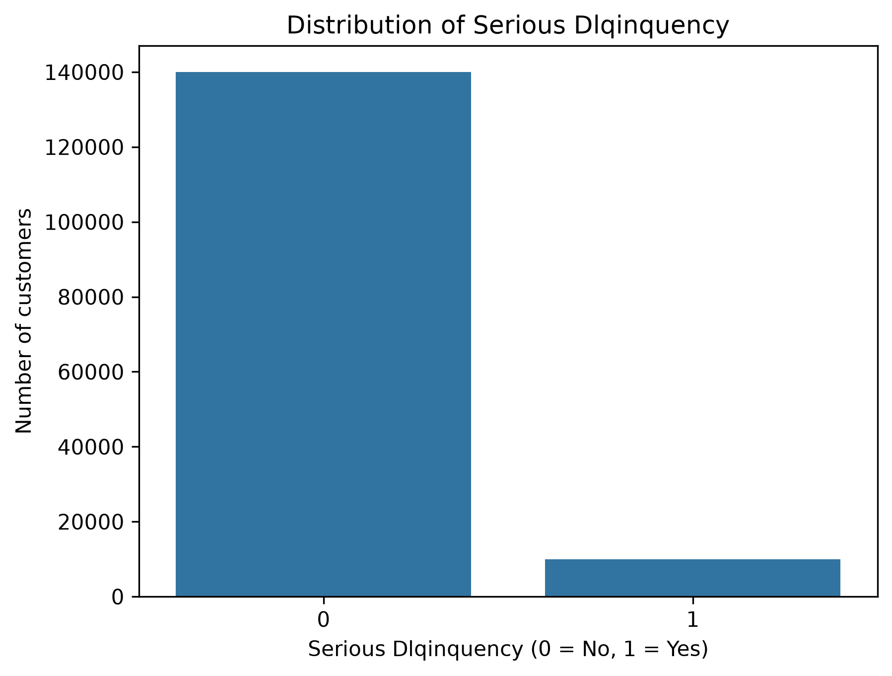
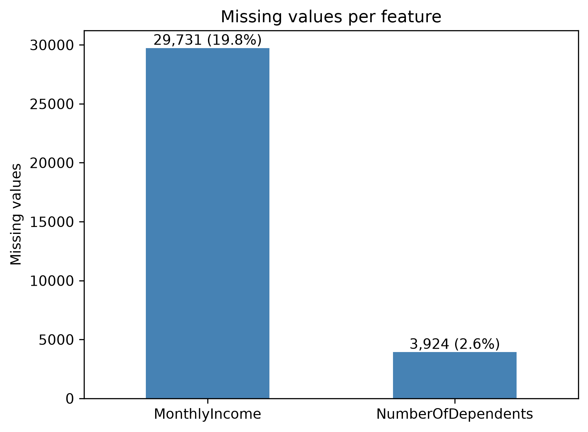
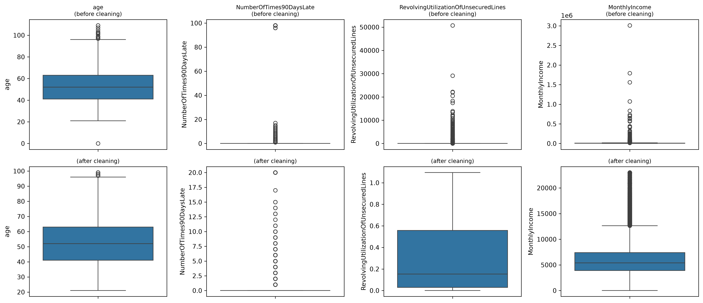
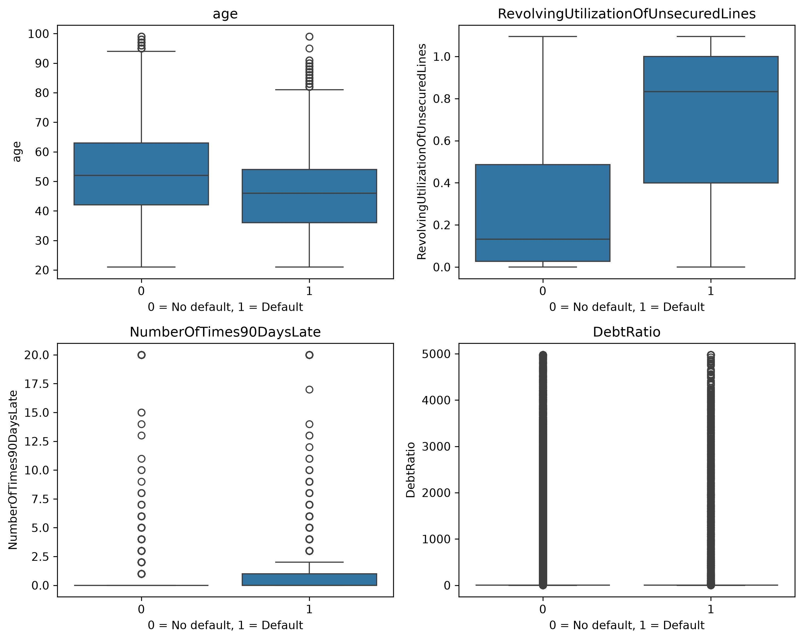
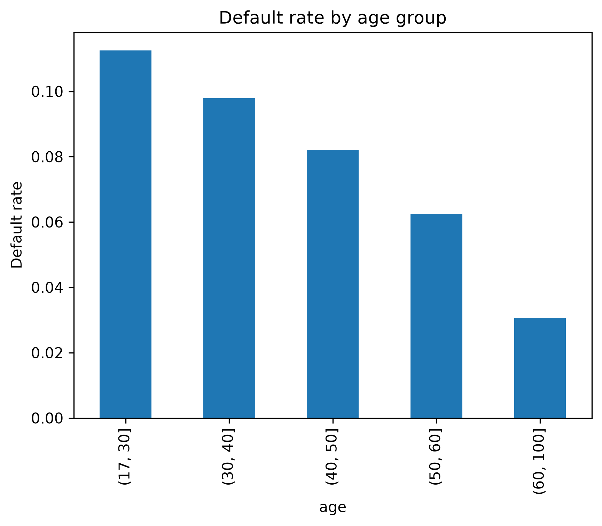
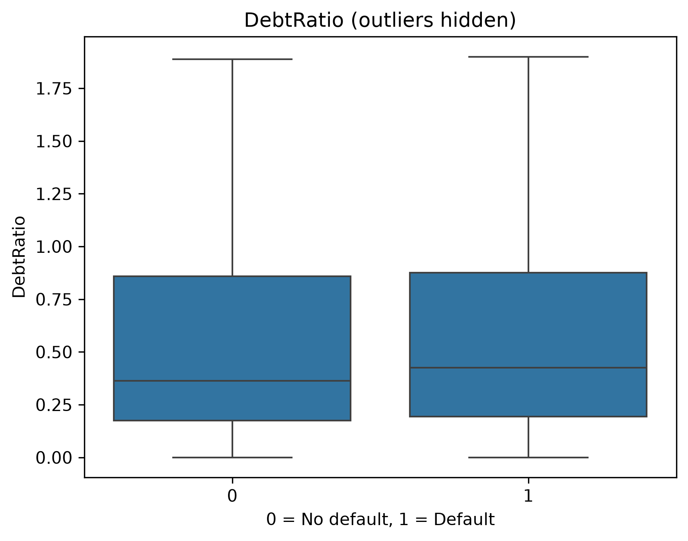
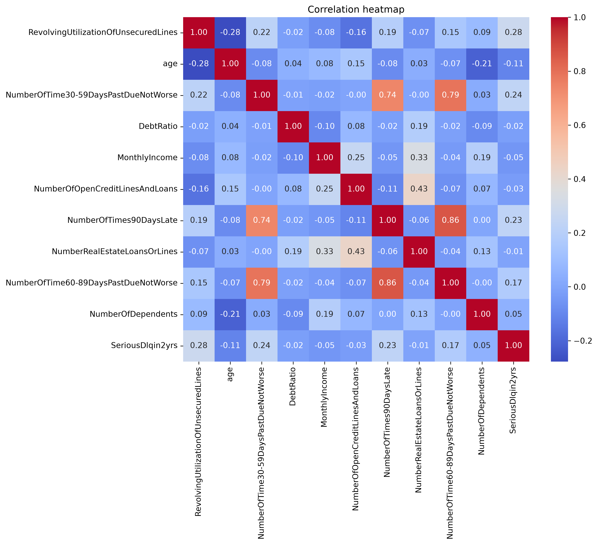

# Data Documentation and EDA Report

**Project:** Explainable Credit Risk Assessment using SHAP-Augmented Gradient Boosting on Imbalanced Financial Data
**Author:** Riya (Data and Preprocessing)
**Notebook:** `member1_data.ipynb`

---

## 1. Dataset Source

| Item | Detail |
|---|---|
| Name | Give Me Some Credit |
| Source | Kaggle competition "Give Me Some Credit" |
| File used | `cs-training.csv` |
| Size | 150,000 borrowers, 10 input features plus 1 target |
| Task | Binary classification: will a borrower experience serious delinquency within 2 years? |

The original file is not stored in the repository (see `.gitignore`); it can be downloaded from Kaggle. The cleaned files used for modeling are in `data/`.

## 2. Target Variable

`SeriousDlqin2yrs`: 1 if the borrower was 90 or more days past due within two years (default), otherwise 0.

## 3. Feature Dictionary

| Feature | Description | Type |
|---|---|---|
| RevolvingUtilizationOfUnsecuredLines | Share of the credit limit that is used | Ratio |
| age | Age of the borrower in years | Integer |
| NumberOfTime30-59DaysPastDueNotWorse | Times the borrower was 30-59 days late | Count |
| DebtRatio | Monthly debt payments divided by monthly income | Ratio |
| MonthlyIncome | Monthly income | Continuous |
| NumberOfOpenCreditLinesAndLoans | Number of open loans and credit lines | Count |
| NumberOfTimes90DaysLate | Times the borrower was 90+ days late | Count |
| NumberRealEstateLoansOrLines | Number of real estate loans | Count |
| NumberOfTime60-89DaysPastDueNotWorse | Times the borrower was 60-89 days late | Count |
| NumberOfDependents | Number of dependents | Count |

## 4. Class Imbalance

| Class | Count | Share |
|---|---|---|
| 0 (no default) | 139,974 | 93.32% |
| 1 (default) | 10,026 | 6.68% |

The imbalance ratio is about 14 to 1. A model that predicts "no default" for everyone would reach about 93% accuracy while detecting no defaulters, so accuracy is not a suitable metric. We will use PR-AUC, recall, KS statistic and calibration, and compare imbalance-handling techniques (class weights, SMOTE, undersampling).



## 5. Missing Values

| Feature | Missing count | Share of 150,000 |
|---|---|---|
| MonthlyIncome | 29,731 | 19.82% |
| NumberOfDependents | 3,924 | 2.62% |
| All other columns | 0 | 0% |

There are no exact duplicate rows.



## 6. Outliers

Statistics below are from the training split before cleaning.

| Feature | Problem observed | Raw value |
|---|---|---|
| age | Impossible and extreme ages | min 0, max 109 |
| NumberOfTime30-59DaysPastDueNotWorse, NumberOfTimes90DaysLate, NumberOfTime60-89DaysPastDueNotWorse | Special codes (96 and 98) instead of real counts: 269 borrowers have 96 or 98 in all three columns at the same time, while real values stop at 17 | max 98 |
| RevolvingUtilizationOfUnsecuredLines | A ratio that should be close to 0 to 1 | max 50,708 |
| DebtRatio | Extreme values; mean 352 against a median of 0.37 | max 329,664 |
| MonthlyIncome | Extreme values; median 5,390 | max 3,008,750 |



## 7. Cleaning and Preprocessing Decisions

| Step | Decision | Reason |
|---|---|---|
| 1. Split first | 80/20 stratified split, `random_state=42` | Keeps the 6.68% default rate in both sets. All statistics for later steps come from the training set only, which prevents data leakage. |
| 2. Missing values | Median imputation with medians from the training set, applied to both sets | Income is highly skewed, so the median is more robust than the mean. Using only training statistics avoids leakage. |
| 3. Invalid ages | Removed rows with age below 18 or above 100 (14 rows: 8 in train, 6 in test) | These values are impossible for a loan applicant. Very few rows were affected. |
| 4. Late-payment counts | Capped at 20 | 269 borrowers (0.18%) have the value 96 or 98 in all three past-due columns simultaneously, while the largest other value is 17. These are not real counts. Their default rate is 54.6% against 6.6% for all other borrowers, so the rows are informative; capping keeps them as the highest values without deleting them. |
| 5. Extreme ratios and income | Capped at the 99th percentile of the training set (utilization 1.09, DebtRatio 4,977, MonthlyIncome 23,000) | Outliers are capped rather than deleted so that no borrowers are lost. Caps come from training data and are applied to both sets. |
| 6. No scaling | Not applied in the data files | Gradient boosting does not need scaling. Scaling for Logistic Regression is done inside the modeling pipeline. |

Results after cleaning: train 119,992 rows, test 29,994 rows, default rate 6.68% in both, no missing values.
**Note on the 96/98 codes:** The dataset documentation does not explain what these values mean, so we treat them as special codes rather than real counts, based on the evidence above. This interpretation is an assumption and could be confirmed with the dataset's source or prior studies that use it.

**Assumption on temporal validity:** The past-due features describe a borrower's history up to the observation date, while the target covers the following two years. We therefore treat these features as available at prediction time and do not regard them as target leakage. This assumption comes from the dataset description and should be confirmed for any real deployment.

**Known limitation:** `DebtRatio` stays unusually large for borrowers whose income was missing (mean about 316 against a median of 0.37 after capping). This is a known quirk of the dataset. Tree-based models are not affected much, so we capped and kept the feature.

## 8. Charts and Initial Findings

### Defaulters versus non-defaulters


| Measure | Non-defaulters | Defaulters |
|---|---|---|
| Median age | 52 | 46 |
| Median credit utilization | 0.13 | 0.83 |

Credit utilization separates the two classes the most. Defaulters are younger. Most non-defaulters have never been 90 days late.

### Default rate by age


| Age group | Default rate |
|---|---|
| 21 to 30 | 11.2% |
| 31 to 40 | 9.8% |
| 41 to 50 | 8.2% |
| 51 to 60 | 6.2% |
| Above 60 | 3.1% |

The default rate falls steadily with age. The youngest group is about 3.6 times more likely to default than the oldest.

### DebtRatio


With outliers hidden, the distributions of both classes can be compared; the raw boxplot is dominated by extreme values.

### Correlations


| Feature | Correlation with target |
|---|---|
| RevolvingUtilizationOfUnsecuredLines | +0.28 |
| NumberOfTime30-59DaysPastDueNotWorse | +0.24 |
| NumberOfTimes90DaysLate | +0.23 |
| NumberOfTime60-89DaysPastDueNotWorse | +0.17 |
| age | -0.11 |
| DebtRatio, MonthlyIncome, OpenCreditLines, RealEstate | close to 0 |

The three past-due features are strongly correlated with each other (0.74 to 0.86), which indicates multicollinearity.

## 9. Implications for Modeling and Explainability

1. The strong imbalance means PR-AUC, recall and KS should be preferred over accuracy.
2. Utilization, past-due counts and age are the expected top risk drivers; SHAP results can be checked against these findings.
3. Correlated past-due features may share SHAP importance, so rankings should be interpreted carefully.
4. Linear correlation is low for DebtRatio and income, but gradient boosting can still capture non-linear effects.

## 10. Reproducibility and Repository Layout

```
data/train.csv, data/test.csv      cleaned datasets (target: SeriousDlqin2yrs)
figures/                           all EDA charts and feature_summary.csv
member1_data.ipynb                 full EDA and preprocessing code
requirements.txt                   Python dependencies
DATA_DOCUMENTATION.md              this document
```

All steps use `random_state=42`. Running `member1_data.ipynb` from top to bottom regenerates the data files and figures.
